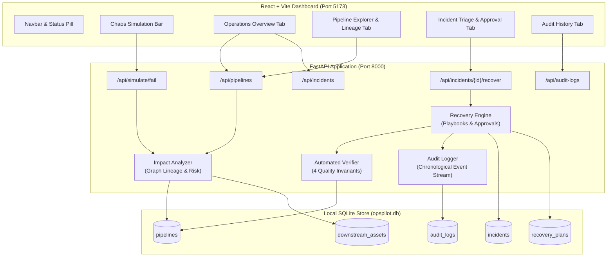

# OpsPilot AI — Intelligent Operations Recovery and Business Impact Analysis Platform

> **Prototype Status:** Hackathon Proof-of-Concept • Local Simulated Operations • Zero Paid API Dependencies

---

## 1. Problem Statement & Motivation

In modern data-driven organizations, analytical dashboards, operational alerts, and executive financial reports depend on complex upstream data engineering pipelines. When an upstream ingestion or transformation pipeline fails:
- **Downstream Blind Spots:** Operations and data engineering teams often do not immediately know which specific reports, business units, or customer SLAs are impacted.
- **Manual & Slow Triage:** Triaging the root cause (e.g., schema drift, missing partitions, gateway timeouts) requires digging through raw logs, orchestrators, and table schemas.
- **Risky Uncontrolled Recovery:** Running ad-hoc bash scripts or re-triggering pipelines without verification can corrupt downstream aggregates, duplicate records, or overwrite valid historical data.
- **No Governance or Auditability:** Ad-hoc manual fixes leave no audit trail of who approved the fix, what recovery playbook ran, or whether data invariants were verified before declaring the issue resolved.

---

## 2. Proposed Solution

**OpsPilot AI** is an intelligent operations recovery and business impact analysis platform. It provides a centralized operations control center that:
1. **Monitors Pipeline Health:** Displays live pipeline status, schedules, and active error signals.
2. **Dynamically Calculates Business Blast Radius:** Traverses database-backed lineage relationships to identify affected downstream dashboards, business units, and illustrative SLA/financial risk.
3. **Formulates Tailored Recovery Playbooks:** Automatically generates deterministic, simulated recovery strategies based on the failure profile.
4. **Enforces Human-in-the-Loop Authorization:** Strictly blocks recovery execution until a qualified engineer reviews and approves the proposed plan.
5. **Orchestrates Controlled Recovery:** Executes a deterministic state-machine workflow (`APPROVED` → `RECOVERING` → `VERIFYING` → `RESOLVED`).
6. **Verifies Data Quality Invariants:** Automatically validates schema compliance, field completeness, record uniqueness, and freshness before resolving incidents.
7. **Maintains a Persistent Audit Trail:** Logs every failure injection, human approval, recovery step, and verification outcome in a chronological audit table.

---

## 3. Key Features

* **Real-Time Operational Monitoring:** Visual indicators for `HEALTHY`, `FAILED`, and `RECOVERING` pipelines.
* **Database-Driven Blast Radius & Lineage:** Traverses real foreign-key relationships between pipelines and downstream business assets to dynamically evaluate criticality (`CRITICAL`, `HIGH`, `MEDIUM`) with transparent human-readable rationales.
* **Controlled Failure Simulation Panel:** Injects realistic data failure scenarios directly into the live SQLite database (`MISSING_PARTITION`, `SCHEMA_MISMATCH`, `API_TIMEOUT`).
* **Intelligent Rule-Based Playbook Recommendation:** Proposes targeted recovery playbooks tailored to the diagnosed failure classification.
* **Strict Human-in-the-Loop Guards:** Recovery cannot execute without explicit confirmation from an operations engineer; rejected plans cannot execute.
* **Multi-Invariant Automated Verifier:** Evaluates Schema Validity, Required-Field Completeness, Duplicate-Record checks, and Data Freshness thresholds.
* **Controlled Verification-Failure Testing:** Includes a demonstration toggle allowing judges to observe safety invariant violation handling (incident remains `UNRESOLVED` and pipeline remains `FAILED`).
* **Governance Audit Stream:** Persistent, application-level audit logging of all lifecycle transitions.

---

## 4. System Architecture



---

## 5. Technology Stack

### Implemented & Actively Used
| Layer | Technologies | Purpose |
|---|---|---|
| **Frontend** | React 19, Vite 8 (8.3.5), Vanilla CSS | Fast, responsive dark-navy operations console with zero external UI bloat |
| **API Client** | Native Fetch API | Centralized, strongly-typed asynchronous REST client with offline detection |
| **Backend** | Python 3.11+, FastAPI, Uvicorn | High-performance asynchronous REST API framework with Swagger OpenAPI documentation |
| **Data Layer** | SQLite, SQLAlchemy 2.0 ORM | Lightweight, zero-config local relational database with thread safety and automated schema creation |
| **Validation** | Pydantic v2 | Strict schema parsing, type checking, and serialization |
| **Testing** | Pytest 8, HTTPX | In-memory SQLite fixture test runner (`StaticPool`) covering 31 test cases |

### Future Architectural Integrations (Not Required for Local Prototype)
* **Orchestration:** Apache Airflow DAG webhooks, dbt Cloud API, Prefect.
* **Storage / Warehouses:** Snowflake, Google BigQuery, AWS Redshift, Apache Iceberg.
* **Auth & Security:** OAuth2 / OIDC, RBAC (Role-Based Access Control) with JWT.
* **Alerting:** Slack webhooks, PagerDuty, OpsGenie.

---

## 6. Project Directory Structure

```
opspilot-ai/
├── README.md                               # Project documentation and demo guide
├── .gitignore                              # Git ignore rules for virtual environments and DBs
├── backend/
│   ├── requirements.txt                    # Pinned Python backend dependencies
│   ├── opspilot.db                         # Local SQLite database file (created on startup)
│   ├── app/
│   │   ├── __init__.py                     # Backend application package
│   │   ├── main.py                         # FastAPI initialization, CORS, and router registration
│   │   ├── database.py                     # SQLite engine, SessionLocal, and init_db()
│   │   ├── models.py                       # SQLAlchemy ORM models (5 core tables)
│   │   ├── schemas.py                      # Pydantic request & response validation models
│   │   ├── seed_data.py                    # Idempotent realistic demo dataset loader
│   │   ├── routers/
│   │   │   ├── __init__.py
│   │   │   ├── pipelines.py                # Pipeline listing, details, and impact endpoints
│   │   │   ├── simulation.py               # Chaos failure simulation & incident query endpoints
│   │   │   ├── recovery.py                 # Plan retrieval, approval, rejection, and recovery endpoints
│   │   │   └── audit.py                    # Incident and global audit trail endpoints
│   │   └── services/
│   │       ├── __init__.py
│   │       ├── impact_analyzer.py          # Dynamic lineage traversal and blast-radius calculator
│   │       ├── recovery_engine.py          # Rule-based playbook generator and state machine runner
│   │       ├── verifier.py                 # 4-point data quality invariant check simulator
│   │       └── audit_service.py            # Audit event persistence and chronological query helper
│   └── tests/
│       ├── __init__.py
│       ├── conftest.py                     # Isolated in-memory SQLite fixture and TestClient
│       ├── test_health_and_db.py           # Health, seeding, and model relationship tests
│       ├── test_pipelines_and_simulation.py# Simulation, 404/400 validation, and blast radius tests
│       └── test_recovery_and_verification.py# Approval guards, verification, and audit tests
└── frontend/
    ├── package.json                        # Frontend npm dependencies and scripts
    ├── vite.config.js                      # Vite bundler configuration
    ├── index.html                          # Application HTML shell
    ├── .env.example                        # Environment variable template
    ├── .env                                # Local frontend environment configuration
    └── src/
        ├── main.jsx                        # React entrypoint
        ├── index.css                       # Dark-navy operations design system tokens and styling
        ├── App.jsx                         # Main dashboard layout and state orchestrator
        ├── App.css                         # App-level styling rules
        ├── assets/                         # Static UI assets
        ├── services/
        │   └── api.js                      # Centralized REST API client
        └── components/
            ├── Navbar.jsx                  # Header brand and backend connectivity status indicator
            ├── SimulationBar.jsx           # Failure injection control panel
            ├── OverviewTab.jsx             # Operations Overview cards and recent activity stream
            ├── PipelineExplorerTab.jsx     # Pipeline catalog and visual downstream impact analysis
            ├── IncidentInvestigationTab.jsx# Root cause diagnosis, approval controls, and verifier checklist
            ├── AuditHistoryTab.jsx         # Searchable and filterable global audit timeline
            └── ConfirmationModal.jsx       # Reusable approval/rejection confirmation dialog
```

---

## 7. Prerequisites & Local Setup Instructions

### Prerequisites
* **Python:** Version 3.11 or higher (Windows: `py -3.11` or `python`)
* **Node.js:** Version 18.0.0 or higher (Installed: v22.19.0)
* **Shell:** Windows PowerShell

---

### Step-by-Step Installation

#### 1. Clone or Open the Repository
```powershell
cd "c:\Users\apste\Desktop\Sania\3RD YEAR\PROJECTS\opspilot-ai"
```

#### 2. Set Up the Python Virtual Environment
```powershell
# Create virtual environment in backend/.venv
py -3.11 -m venv backend\.venv

# Install backend dependencies
.\backend\.venv\Scripts\python.exe -m pip install -r backend\requirements.txt
```

#### 3. Install Frontend Dependencies
```powershell
cd frontend
npm install
cd ..
```

---

## 8. Exact Commands to Run and Test

### Start Backend API Server (Terminal 1)
```powershell
.\backend\.venv\Scripts\python.exe -m uvicorn app.main:app --app-dir backend --reload --port 8000
```
* **Interactive OpenAPI Swagger Docs:** [http://127.0.0.1:8000/docs](http://127.0.0.1:8000/docs)
* **Backend Health Check:** [http://127.0.0.1:8000/api/health](http://127.0.0.1:8000/api/health)

### Start Frontend Application (Terminal 2)
```powershell
cd frontend
npm run dev -- --port 5173 --host
```
* **Web Operations Console:** [http://localhost:5173](http://localhost:5173)

### Run Backend Pytest Suite (31 Automated Tests)
```powershell
.\backend\.venv\Scripts\pytest.exe -v backend\tests
```

### Build Frontend for Production
```powershell
cd frontend
npm run build
```

---

## 9. API Endpoint Specification

### Health & System
| Method | Path | Request Body | Response Schema | Description |
|---|---|---|---|---|
| `GET` | `/` | None | JSON | API metadata, online status, and route catalog |
| `GET` | `/api/health` | None | `HealthResponse` | Verifies DB connectivity and returns total pipeline count |

### Pipelines & Impact Analysis
| Method | Path | Request Body | Response Schema | Description |
|---|---|---|---|---|
| `GET` | `/api/pipelines` | None | `List[PipelineResponse]` | Lists all data pipelines, operational statuses, and schedules |
| `GET` | `/api/pipelines/{id}` | None | `PipelineResponse` | Retrieves detailed metadata for a specific pipeline (`404` if not found) |
| `GET` | `/api/pipelines/{id}/impact` | None | `ImpactReportResponse` | Traverses downstream assets and computes business blast radius |

### Failure Simulation & Incidents
| Method | Path | Request Body | Response Schema | Description |
|---|---|---|---|---|
| `POST` | `/api/simulate/fail` | `SimulateFailureRequest` | `SimulateFailureResponse` | Injects simulated failure (`MISSING_PARTITION`, `SCHEMA_MISMATCH`, `API_TIMEOUT`). Sets status to `FAILED`, creates incident, prevents duplicate active incidents (`400`). |
| `GET` | `/api/incidents` | None | `List[IncidentResponse]` | Lists all operational incidents ordered newest first |
| `GET` | `/api/incidents/{id}` | None | `IncidentResponse` | Retrieves details for an incident (`404` if not found) |

### Human Approval, Recovery & Verification
| Method | Path | Request Body | Response Schema | Description |
|---|---|---|---|---|
| `GET` | `/api/incidents/{id}/recovery-plan` | None | `RecoveryPlanResponse` | Retrieves proposed recovery playbook for an incident |
| `POST` | `/api/incidents/{id}/approve` | `ApprovePlanRequest` | `RecoveryPlanResponse` | Authorizes recovery plan; transitions status to `APPROVED` |
| `POST` | `/api/incidents/{id}/reject` | `RejectPlanRequest` | `RecoveryPlanResponse` | Rejects recovery plan; transitions status to `REJECTED`, blocking execution |
| `POST` | `/api/incidents/{id}/recover` | `RecoverRequest` | `RecoveryExecutionResponse` | Executes recovery state machine: `APPROVED` → `RECOVERING` → `VERIFYING` → `RESOLVED` (or `VERIFICATION_FAILED`) |

### Audit Trail
| Method | Path | Request Body | Response Schema | Description |
|---|---|---|---|---|
| `GET` | `/api/incidents/{id}/logs` | None | `List[AuditLogResponse]` | Chronological audit events for a specific incident |
| `GET` | `/api/audit-logs` | Query: `limit` (int) | `List[AuditLogResponse]` | Global platform audit trail |

---

## 10. Database Models & Schema Relationships

The application uses 5 core tables defined in `backend/app/models.py`:

```
┌─────────────────────────────────┐           ┌─────────────────────────────────┐
│           pipelines             │           │        downstream_assets        │
├─────────────────────────────────┤           ├─────────────────────────────────┤
│ id (PK, Integer)                │1         *│ id (PK, Integer)                │
│ name (String, Unique)           ├───────────┤ pipeline_id (FK -> pipelines.id)│
│ pipeline_key (String, Unique)   │           │ name (String)                   │
│ description (Text)              │           │ asset_type (String)             │
│ status (String: HEALTHY/FAILED) │           │ business_unit (String)          │
│ schedule (String)               │           │ criticality (CRITICAL/HIGH/MED) │
│ last_run_at (DateTime)          │           │ sla_threshold_hours (Integer)   │
│ error_message (Text)            │           │ description (Text)              │
│ created_at / updated_at         │           │ created_at (DateTime)           │
└────────────────┬────────────────┘           └─────────────────────────────────┘
                 │ 1
                 │
                 │ *
┌────────────────▼────────────────┐           ┌─────────────────────────────────┐
│           incidents             │           │         recovery_plans          │
├─────────────────────────────────┤           ├─────────────────────────────────┤
│ id (PK, Integer)                │1         *│ id (PK, Integer)                │
│ pipeline_id (FK -> pipelines.id)├───────────┤ incident_id (FK -> incidents.id)│
│ title (String)                  │           │ action_type (String)            │
│ error_type (String)             │           │ description (Text)              │
│ root_cause (Text)               │           │ playbook_steps (Text)           │
│ severity (CRITICAL/HIGH/MED)    │           │ risk_level (String: LOW/MED/HI) │
│ status (OPEN/APPROVED/RESOLVED) │           │ requires_approval (Boolean)     │
│ business_impact_summary (Text)  │           │ status (PENDING/APPROVED/etc.)  │
│ estimated_sla_breach_mins (Int) │           │ approved_by (String)            │
│ opened_at / resolved_at         │           │ approved_at (DateTime)          │
└────────────────┬────────────────┘           └─────────────────────────────────┘
                 │ 1
                 │
                 │ *
┌────────────────▼────────────────┐
│           audit_logs            │
├─────────────────────────────────┤
│ id (PK, Integer)                │
│ incident_id (FK, Nullable)      │
│ pipeline_id (FK, Nullable)      │
│ action (String)                 │
│ actor (String)                  │
│ details (Text)                  │
│ timestamp (DateTime)            │
└─────────────────────────────────┘
```

---

## 11. End-to-End Demo Walkthrough Guide (3 Minutes)

Follow this script to demonstrate the complete recovery workflow during a hackathon evaluation:

1. **Observe Seeded Pipeline Health:**
   * Open the dashboard at [http://localhost:5173](http://localhost:5173).
   * Notice that `Sales & Revenue ETL` has an active issue while `Customer Activity Stream` and `Inventory & Warehouse Sync` are healthy.
2. **Inspect Downstream Lineage & Blast Radius:**
   * Click on the **Pipeline Explorer** tab.
   * Select `Sales & Revenue ETL`. Observe the dynamic blast radius:
     * **Severity:** `CRITICAL`
     * **Impacted Assets:** 3 assets (*Executive Revenue Briefing*, *Sales Commission Dashboard*, *Daily Stripe Reconciliation*).
     * **SLA & Financial Risk Estimate:** Highlight the illustrative demo estimate box.
3. **Simulate a New Failure (Live Chaos Injection):**
   * Use the **Chaos Simulation Bar** at the top.
   * Target Pipeline: `Inventory & Warehouse Sync`.
   * Failure Scenario: `SCHEMA_MISMATCH`.
   * Click **Simulate Failure**.
   * Observe: Pipeline status immediately changes to `FAILED`, and a new incident is created.
4. **Inspect Incident & Intelligent Recovery Plan:**
   * Click on the **Incident Triage & Recovery** tab.
   * Select the newly opened incident.
   * Notice the proposed strategy: `APPLY_SCHEMA_ADAPTER_FALLBACK`.
   * Point out the safety guard: **The recovery button is disabled** because the plan is in `PENDING_APPROVAL`.
5. **Human-in-the-Loop Authorization:**
   * Click **Approve Recovery Plan**.
   * A confirmation modal appears preventing accidental clicks. Confirm approval.
   * Plan status updates to `APPROVED` with the engineer's name recorded.
6. **Execute Recovery & Automated Invariant Verification:**
   * Click **Execute Approved Recovery Workflow**.
   * The recovery state machine runs:
     * Validates schema compatibility.
     * Checks Required-Field Completeness (0% null violations across 15,420 rows).
     * Validates Duplicate-Record Check (0 duplicate primary keys).
     * Checks Data Freshness (< 15 min threshold).
   * All 4 checks pass: The incident is marked `RESOLVED`, and the pipeline turns `HEALTHY`.
7. **Demonstrate Safety Lock (Verification Failure Mode):**
   * Simulate a failure on any pipeline.
   * Approve the plan.
   * Check the box: **`[Demo Testing] Force Simulated Verification Failure`**.
   * Click **Execute Approved Recovery Workflow**.
   * Observe: Verification fails (*Duplicate-Record Check FAILED: 42 duplicate keys detected*).
   * **Result:** Incident remains `VERIFICATION_FAILED` and pipeline remains `FAILED`. Proves that recovery will never mark an incident resolved if data quality invariants fail.
8. **Inspect the Audit Trail:**
   * Click on the **Audit History** tab.
   * View the persistent, timestamped chronological log of every action taken.

---

## 12. Testing & Verification Summary

### Automated Tests (All Passing)
* **Backend Pytest Suite:** 31 tests passed in 1.70s (`backend/tests/`).
  * `test_health_and_db.py` (6 tests): DB initialization, seeding idempotency, and relationships.
  * `test_pipelines_and_simulation.py` (14 tests): Pipeline endpoints, dynamic impact calculations, failure injection, 400/404 validations, and duplicate active incident prevention.
  * `test_recovery_and_verification.py` (11 tests): Recovery playbooks, approval guards, rejection blocks, verifier invariant checks, controlled verification failure, and audit ordering.
* **Frontend Build Check:** Vite production compilation (`npm run build`) succeeded with 0 errors (sub-second build time, ~400ms–660ms).
* **End-to-End API Integration Script:** Verified the full 9-step user journey against the live running server (`scratch/test_user_journey.py`).

### Browser Testing Notes
* Manual validation was performed via direct local browser access at `http://localhost:5173`.
* Automated browser recording via Playwright was restricted due to sandbox environment network limitations when downloading Playwright binaries. Local interactive access is 100% operational.

---

## 13. Current Prototype Limitations

1. **Simulated Operations Prototype:** Recovery operations and data invariant validations are deterministic simulations designed for safe local demonstrations. Real production warehouses or cloud pipelines are not altered.
2. **Local SQLite Database:** Uses a local file-based SQLite database (`opspilot.db`). Not intended for multi-node distributed concurrency.
3. **Illustrative Financial & SLA Estimates:** Downstream monetary risks are illustrative heuristic estimates based on asset criticality weights ($25k critical, $10k high, $2.5k medium). They do not represent actual realized balance-sheet losses.
4. **No Authentication or Authorization:** The console is open for hackathon demonstration without role-based access control (RBAC).

---

## 14. Future Enhancements

* **Production Orchestrator Webhooks:** Bi-directional webhooks with Apache Airflow, Dagster, and dbt Cloud to trigger actual backfill runs.
* **AST-Based SQL Lineage Parsing:** Dynamic parsing of raw SQL queries to construct real-time dependency graphs without manual asset tagging.
* **LLM Root-Cause Incident Post-Mortems:** Generative incident retrospectives integrating local or cloud LLMs (Gemini / Claude / GPT) to draft post-incident summaries.
* **Enterprise Identity (SSO/RBAC):** Role-based access granting approval authority only to designated on-call SREs and Data Engineers.
