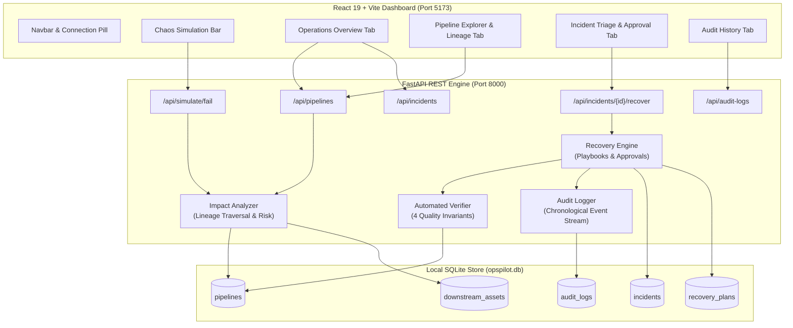

# OpsPilot AI — Intelligent Operations Recovery & Business Impact Analysis Platform

[](LICENSE)
[](https://www.python.org/)
[](https://fastapi.tiangolo.com/)
[](https://react.dev/)
[](https://vitejs.dev/)
[](DEPLOYMENT.md)
[](backend/tests/)
[](https://drive.google.com/file/d/1v03oJmIqFBAeXoDwJh7Vc32NCy9sURp9/view?usp=sharing)

> **Autonomous Incident Triage • Upstream-to-Downstream Lineage Impact Analysis • Human-in-the-Loop Recovery • Automated Invariant Verification**

> 🎥 **Walkthrough Video:** [Watch the OpsPilot AI End-to-End Demo on Google Drive](https://drive.google.com/file/d/1v03oJmIqFBAeXoDwJh7Vc32NCy9sURp9/view?usp=sharing)

---

## 📖 Overview

In modern data-driven organizations, analytical dashboards, operational alerts, and executive financial reports depend on complex upstream data engineering pipelines. When an upstream ingestion or transformation pipeline fails:

* **Downstream Blind Spots:** Operations teams rarely know which specific executive reports, customer SLAs, or business units are impacted.
* **Slow & Risky Triage:** Triaging root causes requires digging through raw orchestrator logs, table schemas, and backfill scripts.
* **Uncontrolled Recovery:** Ad-hoc manual script re-runs risk corrupting downstream aggregates, duplicating records, or overwriting historical data.
* **Missing Auditability:** Manual fixes leave zero audit trail of who approved the action, what playbook executed, or whether data invariants were validated before declaring the incident resolved.

**OpsPilot AI** solves this by providing a unified operations control plane:
1. **Live Pipeline Monitoring:** Real-time visibility into health, schedules, and active failure signals.
2. **Dynamic Blast Radius Calculation:** Traverses database-backed lineage relationships to calculate downstream business impact, affected assets, and illustrative SLA/financial risk.
3. **Tailored Recovery Playbooks:** Automatically synthesizes deterministic recovery strategies based on the failure profile.
4. **Guarded Human-in-the-Loop Controls:** Strictly blocks recovery execution until a qualified engineer reviews and confirms the proposed playbook.
5. **Controlled Workflow Execution:** Coordinates the state machine (`APPROVED` → `RECOVERING` → `VERIFYING` → `RESOLVED`).
6. **Multi-Invariant Automated Verification:** Evaluates Schema Validity, Field Completeness, Record Uniqueness, and Freshness before resolving incidents.
7. **Immutable Audit Stream:** Logs every chaos injection, human approval, recovery step, and verification check to an audit timeline.

---

## 🏗️ System Architecture



---

## ⚡ Quickstart Run Guide

### Option A: Local Development (Default)

#### 1. Start the Backend API (Port 8000)
```powershell
# Windows PowerShell
.\backend\.venv\Scripts\python.exe -m uvicorn app.main:app --app-dir backend --port 8000
```
```bash
# macOS / Linux
source backend/.venv/bin/activate
uvicorn app.main:app --app-dir backend --port 8000
```
* **Interactive Swagger Docs:** [http://127.0.0.1:8000/docs](http://127.0.0.1:8000/docs)
* **API Health Check:** [http://127.0.0.1:8000/api/health](http://127.0.0.1:8000/api/health)

#### 2. Start the Frontend Dashboard (Port 5173)
```bash
cd frontend
npm run dev -- --port 5173 --host
```
* **Web Operations Console:** [http://localhost:5173](http://localhost:5173)

---

### Option B: Docker Compose (One Command)
```bash
docker compose up --build -d
```
* Access the web dashboard at [http://localhost:5173](http://localhost:5173) and backend at [http://localhost:8000](http://localhost:8000).
* See [`DEPLOYMENT.md`](DEPLOYMENT.md) for detailed cloud container deployment.

---

## 🛠️ Step-by-Step Installation & Setup

### Prerequisites
* **Python:** 3.11 or higher
* **Node.js:** 18.0.0 or higher (v20+ recommended)
* **Git**

### 1. Clone Repository
```bash
git clone https://github.com/saniamactelinap/opspilot-ai.git
cd opspilot-ai
```

### 2. Backend Setup
```bash
# Windows
py -3.11 -m venv backend\.venv
.\backend\.venv\Scripts\python.exe -m pip install -r backend\requirements.txt

# macOS / Linux
python3 -m venv backend/.venv
./backend/.venv/bin/pip install -r backend/requirements.txt
```

### 3. Frontend Setup
```bash
cd frontend
npm install
cd ..
```

---

## 🎯 Usage Guide & Interactive Demo Walkthrough

> 🎬 **Watch the Demo:** A full recording of the platform in action is available at:  
> 👉 **[OpsPilot AI Interactive Video Demonstration (Google Drive)](https://drive.google.com/file/d/1v03oJmIqFBAeXoDwJh7Vc32NCy9sURp9/view?usp=sharing)**

Follow this 3-minute guided workflow to test the full lifecycle:

```
┌─────────────────┐       ┌─────────────────┐       ┌─────────────────┐       ┌─────────────────┐
│ 1. Inject Chaos │  ──>  │ 2. Blast Radius │  ──>  │ 3. Human Review │  ──>  │ 4. Verification │
│ Failure Scenario│       │ Lineage Traversal│      │ Plan Approval   │       │ & Incident Close│
└─────────────────┘       └─────────────────┘       └─────────────────┘       └─────────────────┘
```

1. **Observe Seeded Pipeline Health:**
   * Open the console at [http://localhost:5173](http://localhost:5173).
   * Notice pipeline cards with health indicators (`HEALTHY`, `FAILED`, `RECOVERING`).
2. **Inspect Downstream Blast Radius:**
   * Navigate to the **Pipeline Explorer** tab.
   * Select a pipeline (e.g., `Sales & Revenue ETL`).
   * View dynamically calculated downstream business assets, impacted business units, criticality, and illustrative SLA/financial risk.
3. **Simulate a Failure (Live Chaos Injection):**
   * Use the **Chaos Simulation Bar** at the top.
   * Select a target pipeline and choose a failure scenario (`MISSING_PARTITION`, `SCHEMA_MISMATCH`, `API_TIMEOUT`).
   * Click **Simulate Failure**.
   * Observe the pipeline immediately change to `FAILED` and an incident open in the system.
4. **Review Proposed Playbook in Incident Triage:**
   * Open the **Incident Triage & Recovery** tab.
   * View root-cause diagnosis, error traces, and recommended recovery playbooks.
   * **Safety Guard:** Notice that the recovery execution button is disabled while the plan is `PENDING_APPROVAL`.
5. **Authorize the Recovery (Human-in-the-Loop):**
   * Click **Approve Recovery Plan**.
   * Confirm the modal dialog. The plan transitions to `APPROVED` with engineer attribution.
6. **Execute Controlled Recovery & Quality Verification:**
   * Click **Execute Approved Recovery Workflow**.
   * The verifier checks 4 data quality invariants:
     * ✅ **Schema Compatibility:** Matches expected DDL specification.
     * ✅ **Field Completeness:** Null checks on mandatory non-nullable columns.
     * ✅ **Record Uniqueness:** Duplicate primary key detection.
     * ✅ **Data Freshness:** Maximum partition age validation.
   * Once all 4 checks pass, the incident is marked `RESOLVED`, and the pipeline transitions to `HEALTHY`.
7. **Test the Safety Invariant Lock:**
   * Inject another failure, approve the plan, and check **`[Demo Testing] Force Simulated Verification Failure`**.
   * Execute recovery: Verification fails on duplicate records. The incident remains `VERIFICATION_FAILED` and the pipeline remains `FAILED`.
8. **Inspect Immutable Audit History:**
   * Open the **Audit History** tab to view the complete timestamped chronological record of every failure injection, approval, recovery execution, and verification check.

---

## 🔌 API Endpoint Reference

| Method | Endpoint | Request Body | Description |
|---|---|---|---|
| `GET` | `/api/health` | — | System health, DB connection status, and pipeline count |
| `GET` | `/api/pipelines` | — | List all data pipelines, operational states, and schedules |
| `GET` | `/api/pipelines/{id}` | — | Get detailed metadata for a single pipeline |
| `GET` | `/api/pipelines/{id}/impact` | — | Dynamic graph traversal & downstream business blast radius |
| `POST` | `/api/simulate/fail` | `SimulateFailureRequest` | Injects chaos failure scenario into specified pipeline |
| `GET` | `/api/incidents` | — | Lists all operational incidents ordered newest first |
| `GET` | `/api/incidents/{id}` | — | Get detailed incident metadata and failure profile |
| `GET` | `/api/incidents/{id}/recovery-plan` | — | Retrieves recommended recovery playbook for an incident |
| `POST` | `/api/incidents/{id}/approve` | `ApprovePlanRequest` | Authorizes recovery plan (`APPROVED` status) |
| `POST` | `/api/incidents/{id}/reject` | `RejectPlanRequest` | Rejects recovery plan, blocking execution |
| `POST` | `/api/incidents/{id}/recover` | `RecoverRequest` | Executes recovery state machine and 4-point verifier |
| `GET` | `/api/incidents/{id}/logs` | — | Chronological audit trail for a specific incident |
| `GET` | `/api/audit-logs` | `?limit=N` | Global chronological platform audit stream |

---

## 🚀 Deployment Instructions

OpsPilot AI is containerized and ready for production deployment across major platforms:

* **Docker & Docker Compose:** Turnkey local or server deployment with `docker compose up --build -d`.
* **Cloud Containers (GCP Cloud Run / AWS ECS / Render):** Independent container builds for frontend and backend tiers.
* **Bare-Metal Linux (Ubuntu/Debian):** Systemd service management with Nginx reverse proxy.
* **Split Deployment:** Static Vite frontend on Vercel/Netlify with backend hosted on Render/Railway.

👉 **Read the full [Deployment & Run Guide (DEPLOYMENT.md)](DEPLOYMENT.md)** for step-by-step production configs, Nginx reverse proxy setups, and environment variables.

---

## 🧪 Testing & Quality Assurance

### Run Backend Pytest Suite (31 Automated Tests)
```powershell
# Windows
.\backend\.venv\Scripts\pytest.exe -v backend\tests
```
```bash
# macOS / Linux
pytest -v backend/tests
```

### Coverage Highlights
* `test_health_and_db.py`: Database initialization, idempotent seed loading, and ORM relationship integrity.
* `test_pipelines_and_simulation.py`: Dynamic blast radius calculations, failure injection, 400/404 validation, and duplicate incident prevention.
* `test_recovery_and_verification.py`: Approval guards, rejection blocks, 4-point verifier checks, safety invariant lock triggers, and audit logging.

### Frontend Production Build Test
```bash
cd frontend
npm run build
```

---

## 📂 Project Structure

```
opspilot-ai/
├── README.md                               # Project documentation & usage guide
├── DEPLOYMENT.md                           # Production deployment & run guide
├── LICENSE                                 # Apache 2.0 open-source license
├── docker-compose.yml                      # Local multi-tier container orchestration
├── .gitignore                              # Git exclusion rules
├── backend/
│   ├── Dockerfile                          # Production FastAPI container specification
│   ├── requirements.txt                    # Pinned Python dependencies
│   ├── opspilot.db                         # Local SQLite database (auto-created on startup)
│   ├── app/
│   │   ├── main.py                         # FastAPI app entrypoint, CORS, & routers
│   │   ├── database.py                     # SQLite engine & session management
│   │   ├── models.py                       # SQLAlchemy ORM models (5 core tables)
│   │   ├── schemas.py                      # Pydantic request & response validation schemas
│   │   ├── seed_data.py                    # Realistic idempotent seed data loader
│   │   ├── routers/                        # REST endpoint controllers
│   │   │   ├── pipelines.py
│   │   │   ├── simulation.py
│   │   │   ├── recovery.py
│   │   │   └── audit.py
│   │   └── services/                       # Business logic & operations engine
│   │       ├── impact_analyzer.py          # Lineage traversal & blast radius calculator
│   │       ├── recovery_engine.py          # Playbook generation & state machine
│   │       ├── verifier.py                 # 4-point data quality invariant checker
│   │       └── audit_service.py            # Event stream logging service
│   └── tests/                              # Pytest test suite (31 automated tests)
└── frontend/
    ├── Dockerfile                          # Multi-stage production container
    ├── nginx.conf                          # Production Nginx SPA configuration
    ├── package.json                        # Dependencies and build scripts
    ├── vite.config.js                      # Vite bundler configuration
    ├── index.html                          # HTML shell
    └── src/
        ├── main.jsx                        # React entrypoint
        ├── index.css                       # Modern dark-navy operations design system
        ├── App.jsx                         # Main dashboard layout & state management
        ├── services/api.js                 # Centralized typed API client
        └── components/                     # Modular operations UI components
```

---

## 📄 License

This project is licensed under the **Apache License 2.0** — see the [LICENSE](LICENSE) file for complete details.

Copyright (c) 2026 Sania Mactelina and OpsPilot AI Contributors.
